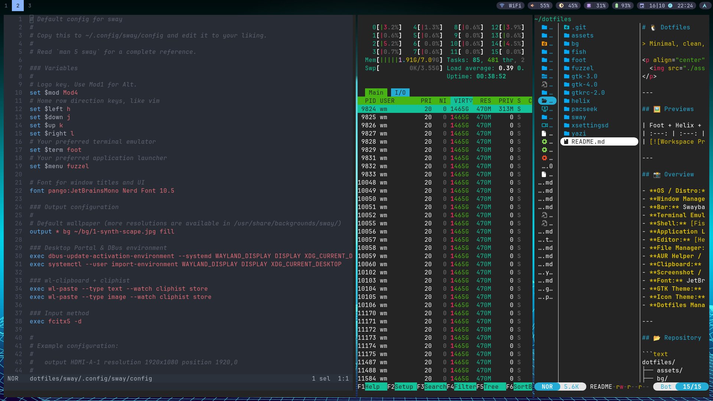
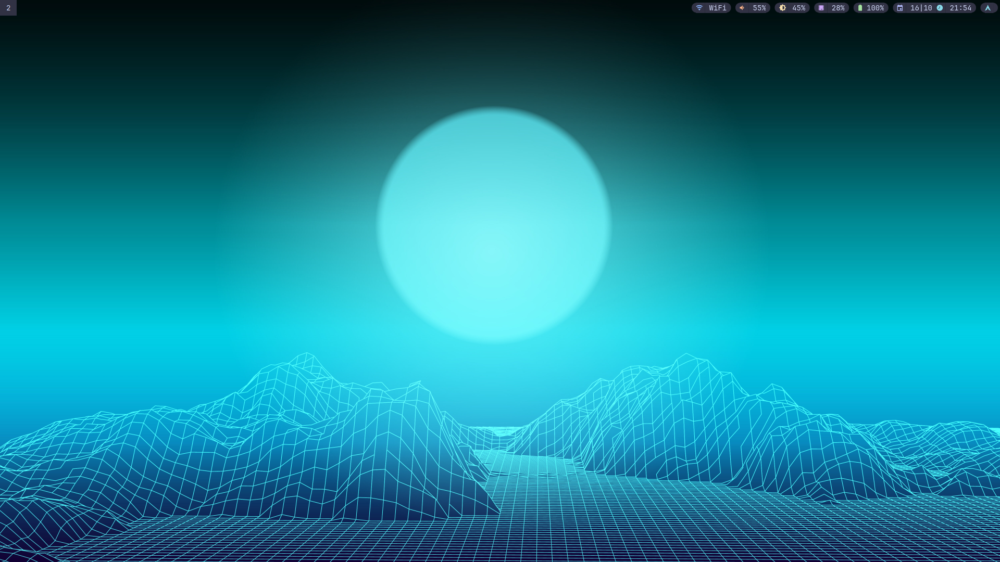

# 🐧 Dotfiles

> Minimal, clean, and productive Wayland desktop configuration powered by **Sway**, styled with **Catppuccin Mocha**, and managed using **GNU Stow**.

<p align="center">
  
</p>

---

## 🖼️ Previews

| Foot + Helix + Yazi | Clean Desktop & Catppuccin Swaybar |
| :---: | :---: |
| [](./assets/preview.png) | [](./assets/desktop.png) |

---

## 📸 Overview

- **OS / Distro:** Arch Linux
- **Window Manager:** [Sway](https://github.com/swaywm/sway) (i3-compatible Wayland compositor)
- **Bar:** Swaybar with custom capsule/pill widgets (`status.sh`) styled in Catppuccin Mocha
- **Terminal Emulator:** [foot](https://codeberg.org/dnkl/foot)
- **Shell:** [Fish Shell](https://fishshell.com/)
- **Application Launcher:** [fuzzel](https://codeberg.org/dnkl/fuzzel)
- **Editor:** [Helix](https://helix-editor.com/) & [Zed](https://zed.dev/)
- **File Manager:** [Yazi](https://github.com/sxyazi/yazi) (TUI) & PCManFM (GUI)
- **AUR Helper / TUI:** `paru` / [pacseek](https://github.com/moson-mo/pacseek)
- **Clipboard:** `wl-clipboard` + `cliphist`
- **Screenshot / Recording:** `grim` + `slurp` + `swappy` / `wf-recorder`
- **Font:** JetBrainsMono Nerd Font
- **GTK Theme:** Catppuccin Mocha Green Standard
- **Icon Theme:** Papirus Dark
- **Dotfiles Manager:** [GNU Stow](https://www.gnu.org/software/stow/)

---

## 📂 Repository Structure

```text
dotfiles/
├── assets/        # Preview screenshots for README
├── bg/            # Wallpapers & lock screen assets (~/bg)
├── fish/          # Fish shell config (~/.config/fish)
├── foot/          # Foot terminal settings (~/.config/foot)
├── fuzzel/        # Fuzzel application launcher (~/.config/fuzzel)
├── gtk-3.0/       # GTK 3 theme & font config (~/.config/gtk-3.0)
├── gtk-4.0/       # GTK 4 theme config (~/.config/gtk-4.0)
├── gtkrc-2.0/     # Legacy GTK 2 config (~/.gtkrc-2.0)
├── helix/         # Helix editor configuration (~/.config/helix)
├── pacseek/       # Pacseek TUI package manager (~/.config/pacseek)
├── sway/          # Sway WM config, swaybar status, & record script (~/.config/sway)
├── xsettingsd/    # XSettings daemon for GTK under Wayland/XWayland (~/.config/xsettingsd)
└── yazi/          # Yazi terminal file manager (~/.config/yazi)
```

---

## ⌨️ Keybindings

The Super key (`Mod4` / Windows key) is used as `$mod`.

### 🚀 Applications & System

| Keybinding | Action |
| :--- | :--- |
| `$mod + Return` | Open terminal (`foot`) |
| `$mod + Space` | Application launcher (`fuzzel`) |
| `$mod + V` | Clipboard manager history (`cliphist` + `fuzzel`) |
| `$mod + C` | Wipe clipboard history |
| `$mod + P` | Open PCManFM file manager |
| `$mod + Z` | Open Zed editor |
| `$mod + B` | Open Helium browser |
| `$mod + X` | Lock screen (`swaylock`) |
| `$mod + Shift + Q` | Close focused window |
| `$mod + Shift + C` | Reload Sway configuration |
| `$mod + Shift + E` | Exit Sway (logout session) |

### 📸 Screenshots & Screen Recording

| Keybinding | Action |
| :--- | :--- |
| `Print` | Interactive screenshot area (`grim` + `slurp` + `swappy`) |
| `Shift + Print` or `$mod + Shift + R` | Toggle area screen recording (`wf-recorder`) |
| `$mod + Print` | Toggle full screen recording (`wf-recorder`) |
| `$mod + Shift + Print` | Toggle area recording with desktop audio |

> *Note: Screen recordings are automatically saved to `~/Videos/recording_<timestamp>.mp4`.*

### 🪟 Window & Workspace Navigation

| Keybinding | Action |
| :--- | :--- |
| `$mod + [h/j/k/l]` or `Arrows` | Move focus left / down / up / right |
| `$mod + Shift + [h/j/k/l]` or `Arrows` | Move container left / down / up / right |
| `$mod + 1..0` | Switch to workspace 1–10 |
| `$mod + Shift + 1..0` | Move container to workspace 1–10 |
| `$mod + F` | Toggle fullscreen |
| `$mod + Shift + Space` | Toggle floating mode |
| `$mod + D` | Toggle focus between tiling and floating |
| `$mod + Shift + Minus` | Send window to scratchpad |
| `$mod + Minus` | Show / cycle scratchpad windows |
| `$mod + R` | Enter resize mode (`Escape` or `Enter` to exit) |

### 🔊 Audio & Brightness Controls

- **Volume:** `XF86AudioRaiseVolume` / `XF86AudioLowerVolume` / `XF86AudioMute` (PipeWire / WirePlumber / PulseAudio)
- **Brightness:** `XF86MonBrightnessUp` / `XF86MonBrightnessDown` (`brightnessctl`)
- *Volume and brightness updates immediately refresh the Swaybar status pill.*

---

## 📦 Dependencies

Install core packages with `pacman` / `paru`:

```bash
# Core Wayland & Sway
paru -S sway swaylock swayidle xorg-xwayland xsettingsd

# Terminal, Shell & Launcher
paru -S foot fish fuzzel

# Status bar & Utilities
paru -S wl-clipboard cliphist grim slurp swappy wf-recorder brightnessctl wireplumber libpulse

# Fonts & Appearance
paru -S ttf-jetbrains-mono-nerd papirus-icon-theme fcitx5 fcitx5-unikey

# Editors & Tools
paru -S helix yazi pcmanfm pacseek stow
```

---

## 🛠️ Installation & Setup

1. **Clone the repository:**

   ```bash
   git clone https://github.com/dmnhut/dotfiles.git ~/dotfiles
   cd ~/dotfiles
   ```

2. **Deploy configurations using GNU Stow:**

   To stow everything:
   ```bash
   stow --target="$HOME" bg fish foot fuzzel gtk-3.0 gtk-4.0 gtkrc-2.0 helix pacseek sway xsettingsd yazi
   ```

   Or stow individual configurations as needed:
   ```bash
   stow sway
   stow foot
   stow fish
   stow fuzzel
   ```

3. **Reload Sway:**
   Press `$mod + Shift + C` to apply the updated configurations immediately.
