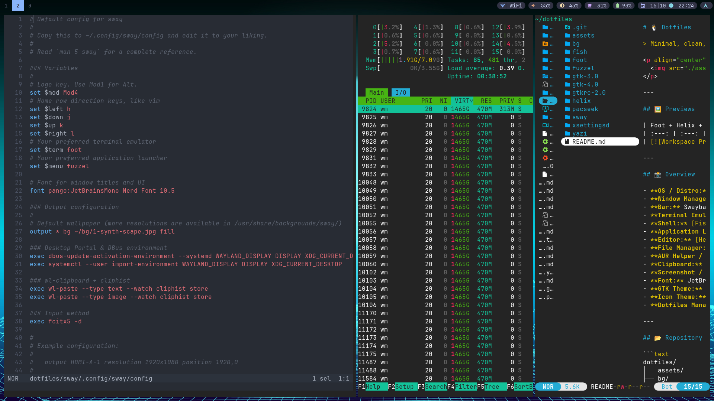
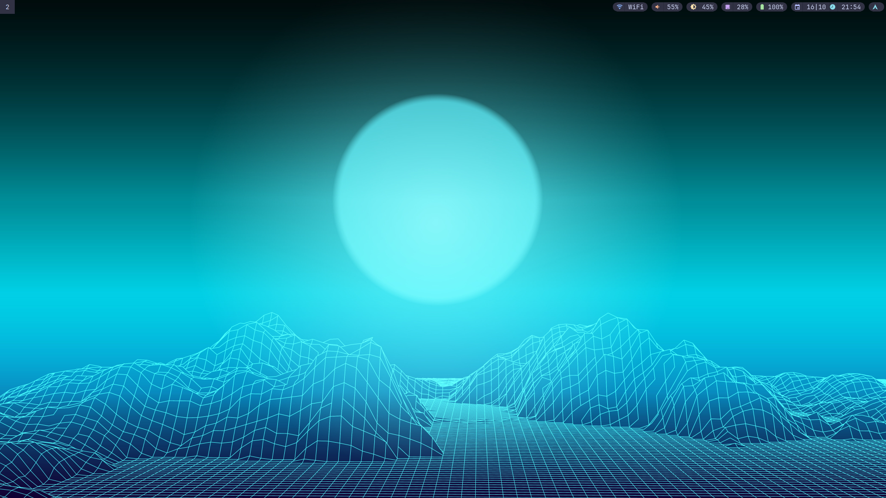

# 🐧 Dotfiles

> Minimal, clean, and productive Wayland desktop configuration for **Arch Linux** powered by **Sway**, styled with **Catppuccin Mocha**, and managed using **GNU Stow** — complete with hardware-agnostic system backup & restore scripts.

<p align="center">
  
</p>

---

## 🖼️ Previews

| Foot + Helix + Yazi | Clean Desktop & Catppuccin Swaybar |
| :---: | :---: |
| [](./assets/preview.png) | [](./assets/desktop.png) |

---

## 📸 Overview

- **OS / Distro:** Arch Linux
- **Window Manager:** [Sway](https://github.com/swaywm/sway) (i3-compatible Wayland compositor)
- **Bar:** Swaybar with custom capsule/pill widgets (`status.sh`) styled in Catppuccin Mocha
- **Terminal Emulator:** [foot](https://codeberg.org/dnkl/foot)
- **Shell:** [Fish Shell](https://fishshell.com/) + [Fisher](https://github.com/jorgebucaran/fisher)
- **Application Launcher:** [fuzzel](https://codeberg.org/dnkl/fuzzel)
- **Editor:** [Helix](https://helix-editor.com/) & [Zed](https://zed.dev/)
- **File Manager:** [Yazi](https://github.com/sxyazi/yazi) (TUI) & PCManFM (GUI)
- **Input Method:** `fcitx5` + `fcitx5-unikey`
- **AUR Helper / TUI:** `paru` / [pacseek](https://github.com/moson-mo/pacseek)
- **Clipboard:** `wl-clipboard` + `cliphist`
- **Screenshot / Recording:** `grim` + `slurp` + `swappy` / `wf-recorder`
- **Audio & Media:** PipeWire + WirePlumber
- **Font:** JetBrainsMono Nerd Font
- **GTK Theme:** Catppuccin Mocha Green Standard
- **Icon Theme:** Papirus Dark
- **Dotfiles Manager:** [GNU Stow](https://www.gnu.org/software/stow/)

---

## 📂 Repository Structure

```text
dotfiles/
├── assets/          # Preview screenshots for README
├── bg/              # Wallpapers & lock screen assets (~/bg)
├── environment.d/   # User environment variables (~/.config/environment.d)
├── fcitx5/          # Fcitx5 & Unikey input method config (~/.config/fcitx5)
├── fish/            # Fish shell & Fisher plugins (~/.config/fish)
├── foot/            # Foot terminal settings (~/.config/foot)
├── fuzzel/          # Fuzzel application launcher (~/.config/fuzzel)
├── gtk-3.0/         # GTK 3 theme & font config (~/.config/gtk-3.0)
├── gtk-4.0/         # GTK 4 theme config (~/.config/gtk-4.0)
├── gtkrc-2.0/       # Legacy GTK 2 config (~/.gtkrc-2.0)
├── helix/           # Helix editor configuration (~/.config/helix)
├── mimeapps/        # Default application associations (~/.config/mimeapps.list)
├── pacseek/         # Pacseek TUI package manager (~/.config/pacseek)
├── pcmanfm/         # PCManFM & LibFM settings (~/.config/pcmanfm, ~/.config/libfm)
├── sway/            # Sway WM config, swaybar status, & record script (~/.config/sway)
├── system/          # Sanitized /etc configs, package lists (pacman/AUR), & systemd services
├── xsettingsd/      # XSettings daemon for GTK under Wayland/XWayland (~/.config/xsettingsd)
├── yazi/            # Yazi terminal file manager (~/.config/yazi)
├── zed/             # Zed editor settings & keymap (~/.config/zed)
├── backup.sh        # Automated backup of packages, services, and sanitized /etc files
└── restore.sh       # Automated full-system & dotfiles restoration script
```

---

## ⌨️ Keybindings

The Super key (`Mod4` / Windows key) is used as `$mod`.

### 🚀 Applications & System

| Keybinding | Action |
| :--- | :--- |
| `$mod + Return` | Open terminal (`foot`) |
| `$mod + Space` | Application launcher (`fuzzel`) |
| `$mod + V` | Clipboard manager history (`cliphist` + `fuzzel`) |
| `$mod + C` | Wipe clipboard history |
| `$mod + P` | Open PCManFM file manager |
| `$mod + Z` | Open Zed editor (`zeditor`) |
| `$mod + B` | Open Helium browser |
| `$mod + M` | Trigger left mouse click at cursor |
| `$mod + X` | Lock screen (`swaylock`) |
| `$mod + Shift + Q` | Close focused window |
| `$mod + Shift + C` | Reload Sway configuration |
| `$mod + Shift + E` | Exit Sway (logout session) |
| `$mod + Escape` | Power off system (`poweroff`) |

### 📸 Screenshots & Screen Recording

| Keybinding | Action |
| :--- | :--- |
| `Print` | Interactive screenshot area (`grim` + `slurp` + `swappy`) |
| `Shift + Print` | Toggle area screen recording (`wf-recorder`) |
| `$mod + Print` | Toggle full screen recording (`wf-recorder`) |
| `$mod + Shift + Print` | Toggle area recording with desktop audio |

> *Note: Pressing the recording keybinding again stops the recording and saves it to `~/Videos/recording_<timestamp>.mp4`.*

### 🪟 Window & Workspace Navigation

| Keybinding | Action |
| :--- | :--- |
| `$mod + [h/j/k/l]` or `Arrows` | Move focus left / down / up / right |
| `$mod + Shift + [h/j/k/l]` or `Arrows` | Move container left / down / up / right |
| `$mod + 1..0` | Switch to workspace 1–10 |
| `$mod + Shift + 1..0` | Move container to workspace 1–10 |
| `$mod + Shift + B` / `$mod + Shift + V` | Split container horizontally / vertically |
| `$mod + S` / `$mod + W` / `$mod + E` | Layout stacking / tabbed / toggle split |
| `$mod + F` | Toggle fullscreen |
| `$mod + Shift + Space` | Toggle floating mode |
| `$mod + D` | Toggle focus between tiling and floating |
| `$mod + Shift + Minus` | Send window to scratchpad |
| `$mod + Minus` | Show / cycle scratchpad windows |
| `$mod + R` | Enter resize mode (`Escape` or `Enter` to exit) |

### 🔊 Audio & Brightness Controls

- **Volume:** `XF86AudioRaiseVolume` / `XF86AudioLowerVolume` / `XF86AudioMute` / `XF86AudioMicMute` (PipeWire / WirePlumber / PulseAudio)
- **Brightness:** `XF86MonBrightnessUp` / `XF86MonBrightnessDown` (`brightnessctl`)
- *Volume and brightness updates immediately refresh the Swaybar status pill via `SIGUSR1`.*

---

## 🛠️ Installation & Usage

### 1. Clone the Repository

```bash
git clone https://github.com/dmnhut/dotfiles.git ~/dotfiles
cd ~/dotfiles
```

### 2. Option A: Full System & Dotfiles Restore (Arch Linux)

Run [`restore.sh`](./restore.sh) on a fresh or existing Arch Linux installation to replicate the entire environment:

```bash
chmod +x restore.sh
./restore.sh
```

**What `restore.sh` does automatically:**
1. Installs all official packages from `system/pkglist.txt` and auto-detects CPU microcode (`amd-ucode` / `intel-ucode`).
2. Installs `paru` (if missing) and all AUR packages from `system/aurlist.txt`.
3. Links all user dotfiles into `$HOME` via **GNU Stow**.
4. Restores `/etc` system configurations, dynamically detects GPU (`amdgpu` / `i915`) and NVMe modules for `/etc/mkinitcpio.conf`, populates `/etc/kernel/cmdline` with the current machine's root `PARTUUID`, and regenerates locales & initramfs.
5. Enables essential system and user `systemd` services (`iwd`, `systemd-networkd`, `pipewire`, `wireplumber`, `auto-cpufreq`, `earlyoom`, etc.).
6. Installs [Fisher](https://github.com/jorgebucaran/fisher) and updates Fish shell plugins.

### 3. Option B: Stow Dotfiles Only

If you only want to link the user configurations without modifying system packages or `/etc`:

```bash
# Stow all user configurations
stow --target="$HOME" \
  bg environment.d fcitx5 fish foot fuzzel \
  gtk-3.0 gtk-4.0 gtkrc-2.0 helix mimeapps \
  pacseek pcmanfm sway xsettingsd yazi zed
```

Or stow individual modules as needed:

```bash
stow sway foot fish fuzzel zed
```

Press `$mod + Shift + C` inside Sway to reload the configuration immediately.

---

## 🔄 Backing Up Changes

Run [`backup.sh`](./backup.sh) whenever you install new packages or tweak system configurations:

```bash
./backup.sh
```

- Exports explicitly installed native packages (`system/pkglist.txt`, excluding CPU-specific microcode) and AUR packages (`system/aurlist.txt`).
- Records enabled system and user `systemd` units (`system/services-system.txt`, `system/services-user.txt`).
- Copies and sanitizes key `/etc` files into `system/etc/` (strips machine-specific `UUID`/`PARTUUID` and hardware modules so the repo stays clean and portable across machines).
